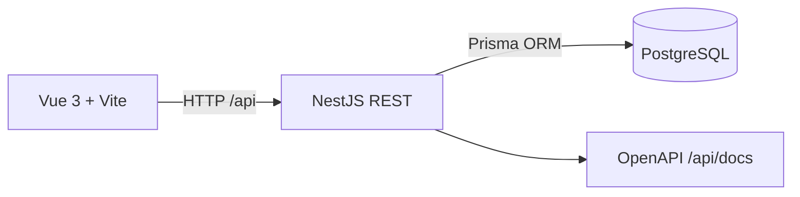

# Arquitectura del backend de Fase 1A

NestJS organiza autenticación, usuarios, roles y auditoría en módulos. Prisma persiste sesiones, tokens con hash y permisos efectivos en PostgreSQL. Mailpit captura invitaciones y recuperación en desarrollo. Las escrituras administrativas atraviesan sesión, CSRF y permiso granular. No hay módulos de expedientes ni servicios cloud.

El repositorio usa pnpm workspaces: `apps/web` contiene el cliente, `apps/api` la API y `packages/shared` contratos futuros. Docker Compose ejecuta servicios separados para web, API y PostgreSQL. La configuración de base de datos está concentrada en `DATABASE_URL`, por lo que una migración futura a PostgreSQL administrado solo exige cambiar ese valor y las credenciales.

Para desarrollo, Compose monta el código fuente y usa los volúmenes nombrados `api_node_modules` y `web_node_modules` para ocultar los `node_modules` del host. Los ejecutables se resuelven desde el `node_modules` raíz de la imagen, instalado por pnpm para el workspace completo. Así se conserva la recarga automática sin mezclar enlaces simbólicos de Windows con rutas Linux.

Se eligieron Vue 3, Vite, NestJS y PostgreSQL por compatibilidad TypeScript y un modelo operativo simple. No se incluyen servicios cloud, microservicios ni funcionalidades de negocio durante esta fase.
